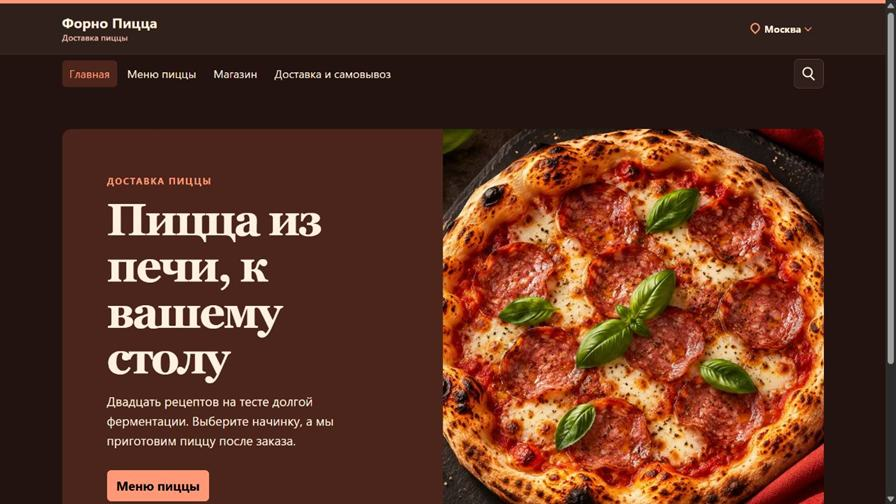
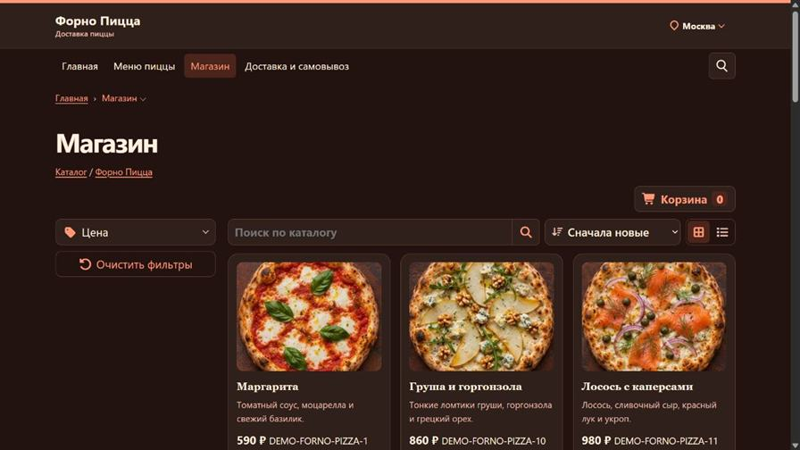
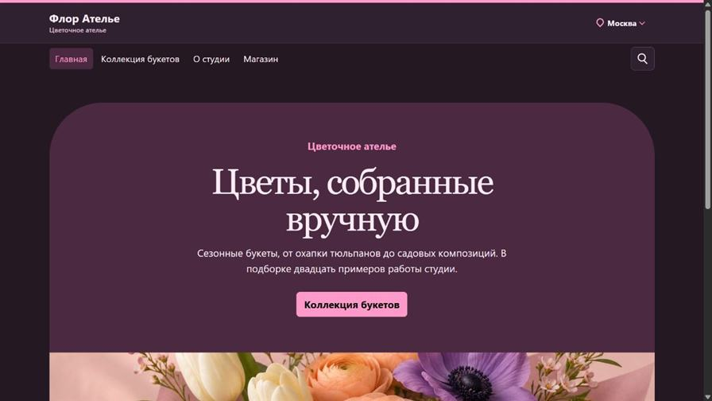
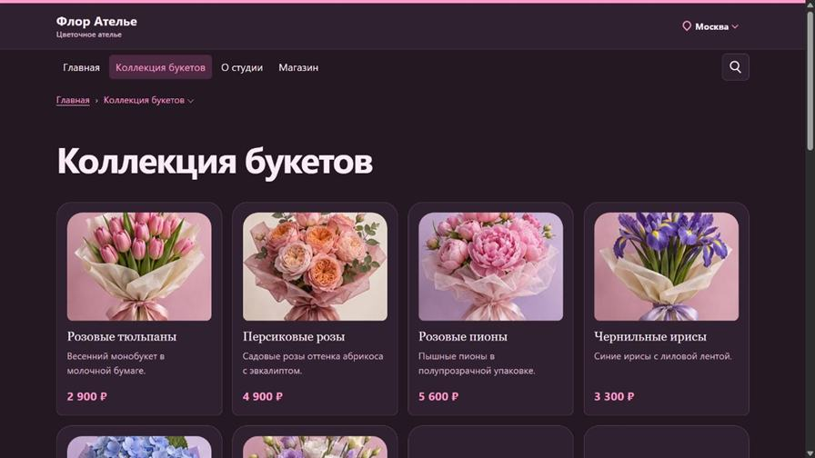
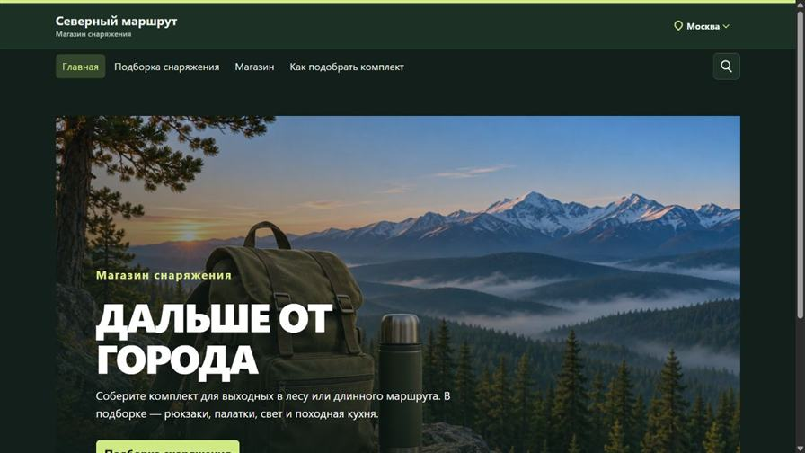
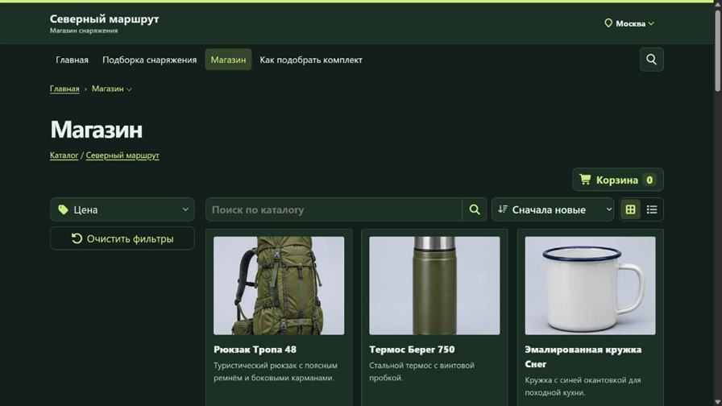
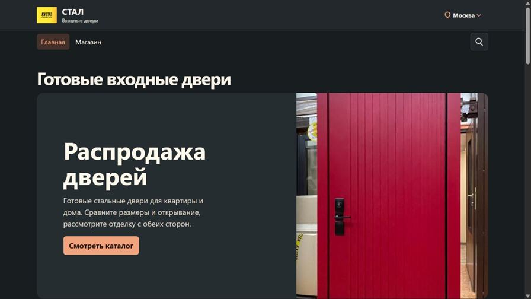
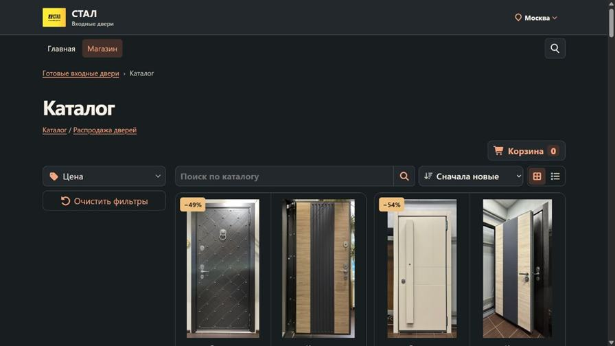

# Магазин тем EWC Lite

В админке откройте **Дизайн → Магазин тем**. Установите оформление отдельно или включите демо-страницы. После установки выберите тему в поле «Активная тема» и нажмите «Применить».

| Тема | Готовый сайт | Оформление витрины | Магазин в готовом сайте |
| --- | --- | --- | --- |
| [Форно Пицца](packages/forno-pizza.json) | Да | Да | Да |
| [Флор Ателье](packages/flor-atelier.json) | Да | Нет | Нет |
| [Северный маршрут](packages/sever-trail.json) | Да | Да | Да |

Каждый пакет содержит обложку, светлую и тёмную палитры, демо-страницы и 20 позиций с изображениями. В магазине тем нажмите «Загрузить демо-товары» и отметьте нужные позиции. EWC добавит их в отдельный раздел каталога. Для импорта и корзины нужен включённый модуль маркетплейса.

`catalog.json` содержит версии, признаки и SHA-256 пакетов. Файлы в `packages/` состоят из данных. Шаблоны и стили генерирует установленная CMS.

## Снимки тем

| Тема | Главная | Магазин или коллекция |
| --- | --- | --- |
| Форно Пицца |  |  |
| Флор Ателье |  |  |
| Северный маршрут |  |  |
| СТАЛ · Готовые двери |  |  |

Для темы СТАЛ откройте «Загрузить демо-товары» и выберите «Распродажа дверей». Мастер сохраняет резервную копию каталога перед импортом.
